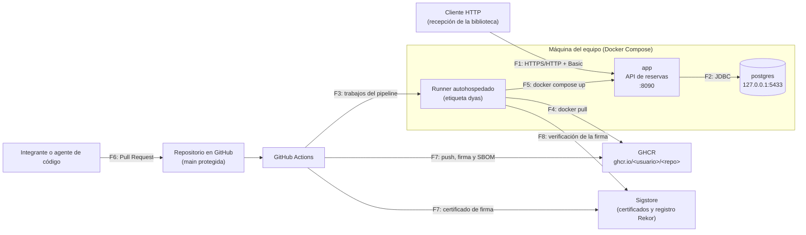

# Seguridad del servicio de reservas

Este documento tiene cuatro partes: el modelo de amenazas (STRIDE), el inventario de los datos personales que maneja el sistema, los controles de seguridad del pipeline con sus umbrales y el registro de hallazgos.

## 1. Componentes y flujos analizados

## 2. Modelo de amenazas (STRIDE)

| ID | Categoría STRIDE | Componente o flujo | Amenaza | Mitigación | Cómo se verifica |
|---|---|---|---|---|---|
| A1 | Suplantación (S) | F1, `app` | Alguien sin credenciales crea o cancela reservas, o se hace pasar por un gestor. | Autenticación HTTP Basic en toda la API; claves de al menos 12 caracteres que llegan por variables de entorno desde GitHub Secrets; el autor de la reserva se toma del usuario autenticado (`registradaPor`), no del cuerpo de la petición. | `ReservaControllerTest` (`sinCredencialesRespondeNoAutorizado`, `conUnaClaveIncorrectaRespondeNoAutorizado`); paso 3 de `scripts/smoke-test.sh` (espera 401 en cada despliegue). |
| A2 | Manipulación (T) | F1 → F2 | Datos de entrada manipulados: inyección SQL, horarios fuera de rango, cuerpos incompletos. | Consultas de Spring Data con parámetros (sin concatenar SQL); validación de formato con Bean Validation; reglas de negocio en el dominio; la API solo acepta `application/json`. | SAST con CodeQL (job `sast`); `ReservaTest`; `rechazaUnCuerpoIncompletoSinLlamarAlCasoDeUso`; `soloAceptaJson`. |
| A3 | Manipulación (T) | F4, F7, imagen | Se despliega una imagen alterada, una imagen que no construyó el pipeline (por ejemplo, subida a mano al registro con una credencial filtrada) o una imagen con una dependencia vulnerable (cadena de suministro). | Imágenes base con versión fija; Trivy sobre dependencias e imagen; Dependabot; herramientas de seguridad con versión fija. El job `publicar` firma el digest de la imagen con la identidad de `cd.yml` (firma sin llaves de Sigstore) y le adjunta su SBOM; `desplegar` y `revertir` verifican la firma y despliegan por digest, así que una imagen sin firma, firmada por otro workflow o con la etiqueta movida no se despliega. | Jobs `sca` e `imagen`; paso *Quality gate de la imagen* de `publicar`; paso *Verificar la firma de la imagen* de `desplegar` y `revertir` (`scripts/verificar-firma.sh`). |
| A4 | Repudio (R) | `app` | Un gestor niega haber creado o cancelado una reserva. | Cada reserva guarda quién la registró (`registradaPor`); el registro `auditoria` escribe acción, reserva y usuario en cada creación y cancelación. | `elGestorCreaUnaReservaYQuedaRegistradoComoAutor`; `creaGuardaEnPostgresYConsultaUnaReserva` (`ReservasApiIT`). Límite: los logs viven en el contenedor (ver H-06). |
| A5 | Divulgación de información (I) | repositorio, imagen, F1 | Una contraseña o token queda en el código, en el historial o en la imagen; un error muestra la traza de la pila; Actuator expone variables de entorno. | Gitleaks sobre todo el historial; `.env` en `.gitignore` y en `.dockerignore`; configuración solo por variables de entorno; `server.error.include-stacktrace=never`; Actuator solo expone `health` e `info`; consultar reservas (que tienen correos) exige autenticación. | Job `secretos`; `lasRutasNoDeclaradasQuedanBloqueadas` (`/actuator/env` responde 403). |
| A6 | Denegación de servicio (D) | `app`, `postgres` | Un pico de peticiones o una consulta lenta deja el servicio sin responder. | Límites de CPU y memoria en `docker-compose.yml`; la consulta de reservas es de un solo día y usa índice; el SLO se verifica con carga en cada despliegue; reinicio automático (`restart: unless-stopped`). | `scripts/slo.sh` (k6, p95 < 500 ms, errores < 1 %) en el job `desplegar`. Límite: no hay limitación de tasa por cliente (ver H-07). |
| A7 | Elevación de privilegios (E) | `app`, runner | (a) Un atacante que logra ejecutar código en la aplicación toma control del contenedor o de la máquina. (b) Un Pull Request de un repositorio externo (fork) ejecuta código en el runner autohospedado. (c) Un usuario de consulta intenta crear reservas. | (a) Usuario sin privilegios (UID 10001), `cap_drop: ALL`, `no-new-privileges`, sistema de archivos de solo lectura. (b) Los Pull Requests corren en runners de GitHub; el runner solo atiende jobs de `main`, tags y la reversión manual dentro del environment `produccion`; en repositorios públicos se exige aprobación para workflows de colaboradores externos. (c) Autorización por roles (CONSULTA no puede escribir). | `docker compose exec app id` (uid=10001); `elRolConsultaPuedeListarPeroNoCrear` (403); en `cd.yml` solo los jobs `desplegar` y `revertir` usan `self-hosted`, y `cd.yml` no se dispara con `pull_request`. |
| A8 | Divulgación de información (I) | F2, `postgres` | La base de datos queda expuesta en la red. | El puerto de PostgreSQL solo se publica en `127.0.0.1`; la aplicación se conecta por la red interna de Compose. | `docker compose ps` muestra `127.0.0.1:5433->5432/tcp`. |
| A9 | Manipulación (T) | F6, repositorio | Un cambio generado por un asistente o agente de código rompe una frontera de la arquitectura, baja un umbral, registra una excepción sin justificar o agrega una dependencia que no existe o suplanta a una conocida (paquete con un nombre parecido al que el modelo "recordó"). | `AGENTS.md` con las reglas de arquitectura y de seguridad del repositorio (control antes del cambio); `main` protegida con Pull Request, una aprobación humana y todos los checks obligatorios (control después del cambio); ArchUnit, SCA y Gitleaks no distinguen quién escribió el código. | Ejercicio 7 del README; ruleset `proteger-main`; jobs `build-pruebas`, `sca` y `secretos`. |

## 3. Inventario de datos personales

El inventario responde qué datos de personas maneja el sistema, dónde quedan y si salen de él. Es la base para decidir qué proteger y qué no guardar.

| Dato | Para qué se usa | Dónde queda | Quién lo puede leer | ¿Sale del sistema? | Retención |
|---|---|---|---|---|---|
| Correo institucional del responsable de la reserva | Identificar a quién se le asignó la sala | Tabla `reservas` en PostgreSQL | Usuarios GESTOR y CONSULTA de la API (exige autenticación) | No | Mientras exista la reserva. No hay borrado automático (ver H-09). |
| Usuario que registró o canceló la reserva (`registradaPor`) | Auditoría (A4) | Tabla `reservas` y logs del contenedor (`auditoria`) | GESTOR y CONSULTA; quien administra la máquina (logs) | No | Base de datos: mientras exista la reserva. Logs: hasta que se recrea el contenedor (H-06). |
| Claves de los usuarios de la API | Autenticación | GitHub Secrets (environment `produccion`) o `.env` local; en la aplicación, solo el hash BCrypt en memoria | Administradores del repositorio (no pueden volver a leer el valor en GitHub) | No | Hasta que se rotan. |
| Datos de las pruebas | Prueba de humo y prueba de carga | La base de datos desplegada (las reservas de prueba se cancelan) y los reportes de k6 | Integrantes del equipo | Los reportes se publican como artefactos de GitHub Actions; no contienen correos reales | 90 días (retención por defecto de los artefactos). |

Lo que el sistema **no** hace, a propósito: no guarda la dirección IP de los clientes, no envía datos a servicios de analítica ni a modelos de lenguaje, y los mensajes de error no devuelven datos de otras reservas. Si un cambio futuro envía datos a un servicio externo (por ejemplo, un asistente con un modelo de lenguaje), primero se agrega una fila a esta tabla y una amenaza al modelo STRIDE.

## 4. Controles del pipeline

Los cuatro controles de análisis funcionan como *quality gates*: si encuentran un problema por encima del umbral, el job falla y el Pull Request no se puede fusionar. Se pueden ejecutar en local con los mismos scripts que usa el pipeline. La verificación de la firma es un quality gate del despliegue: si falla, la imagen no se despliega.

| Control | Herramienta | Script / job | Umbral mínimo | Umbral de este repositorio |
|---|---|---|---|---|
| Análisis estático (SAST) | CodeQL | `scripts/umbral-sast.sh` / `sast` | Ningún hallazgo alto o crítico sin tratar | `security-severity` ≥ 7.0 sin registro en este documento |
| Análisis de dependencias (SCA) | Trivy `fs` + Dependabot | `scripts/sca.sh` / `sca` | Ninguna vulnerabilidad alta o crítica con corrección | HIGH o CRITICAL con corrección (`--severity HIGH,CRITICAL --ignore-unfixed`) |
| Detección de secretos | Gitleaks | `scripts/secretos.sh` / `secretos` | Cero secretos, incluido el historial | Cero secretos en todos los commits (`gitleaks git`) |
| Escaneo de la imagen | Trivy `image` | `scripts/escaneo-imagen.sh` / `imagen` y `publicar` | Ninguna vulnerabilidad crítica con corrección | CRITICAL con corrección (`--severity CRITICAL --ignore-unfixed`) |
| Firma de la imagen (cadena de suministro) | cosign 3.1.3 (Sigstore, firma sin llaves) | `publicar` firma; `scripts/verificar-firma.sh` / `desplegar` y `revertir` verifican | No lo exige el enunciado | No se despliega una imagen sin una firma de `cd.yml` de este repositorio, desde `main` o desde un tag `vX.Y.Z` |
| SBOM | Trivy (CycloneDX) | `scripts/sbom.sh` / `imagen` y `publicar` | No lo exige el enunciado | No detiene el pipeline: se publica como artefacto y se adjunta a la imagen como atestación |

Cómo se registra una excepción:

- **CodeQL:** una línea `<regla> <archivo>` en `.github/codeql/excepciones-sast.txt`.
- **Trivy:** el identificador de la vulnerabilidad en `.trivyignore`.
- **Gitleaks:** la huella (*fingerprint*) del hallazgo en `.gitleaksignore`, solo para falsos positivos. Un secreto real nunca se ignora: se rota y se elimina.

Toda excepción debe aparecer en la tabla siguiente. Una excepción sin registro, o un umbral relajado, cuenta como un control no implementado.

## 5. Registro de hallazgos

| ID | Control | Hallazgo | Decisión | Justificación o corrección |
|---|---|---|---|---|
| H-01 | SAST (CodeQL) | `java/spring-disabled-csrf-protection` (severidad 8.8) en `SeguridadConfig.java`: la protección CSRF está desactivada. | Riesgo aceptado | La API no usa sesiones ni cookies (`SessionCreationPolicy.STATELESS`) y solo acepta `application/json`: un formulario de otro sitio no puede enviar ese tipo de contenido sin una solicitud previa de CORS, y CORS no está habilitado. El riesgo que queda es que un navegador que guardó las credenciales Basic las reenvíe. **Para corregirlo:** reemplazar HTTP Basic por tokens Bearer (OAuth 2.0 / OpenID Connect con el proveedor de identidad de la universidad). Registrado en `.github/codeql/excepciones-sast.txt`. |
| H-02 | Prueba de carga (SLO) | Con BCrypt de costo 10 (valor por defecto), cada petición autenticada tarda decenas de milisegundos en verificar la clave y la prueba de carga incumple el SLO (p95 de varios segundos a 20 iteraciones por segundo). | Riesgo aceptado | Se usa BCrypt de costo 4 (`SeguridadConfig.COSTO_BCRYPT`). Los hashes solo existen en memoria: las claves llegan por variables de entorno y nunca se guardan en disco ni en la base de datos, así que un costo alto no protege contra el robo de una base de hashes. **Para corregirlo:** autenticación con tokens, que se validan sin recalcular un hash en cada petición. |
| H-03 | SCA (Trivy) | `tomcat-embed-core` 11.0.24, incluida por Spring Boot 4.1.1: tres vulnerabilidades CRITICAL con corrección (CVE-2026-65182, CVE-2026-65905, CVE-2026-68525). | Corregido | Se fija `<tomcat.version>11.0.26</tomcat.version>` en `pom.xml` (commit `60aeab1`). Se quita cuando una versión de Spring Boot ya traiga la corrección. |
| H-04 | SCA (Trivy) | `jackson-core` y `jackson-databind` 3.1.5: cinco vulnerabilidades HIGH de denegación de servicio con corrección (CVE-2026-89407, CVE-2026-89425, CVE-2026-68497, CVE-2026-91776, CVE-2026-91777). | Corregido | Se fija `<jackson-bom.version>3.1.7</jackson-bom.version>` en `pom.xml` (commit `60aeab1`). |
| H-05 | Imagen (Trivy) | Vulnerabilidades MEDIUM y LOW en paquetes de Ubuntu 24.04 de la imagen base `eclipse-temurin`, sin corrección publicada. | Riesgo aceptado | Están por debajo del umbral y no tienen corrección disponible. Dependabot propone las nuevas versiones de la imagen base; el reporte completo queda en el artefacto `reporte-imagen`. |
| H-06 | Modelo de amenazas (A4) | El registro de auditoría vive en los logs del contenedor y se pierde al recrearlo. | Riesgo aceptado | Para un sistema académico de un solo servidor es suficiente con `docker compose logs`. **Para corregirlo:** centralizar los logs (Loki o ELK) o guardar la cancelación y su autor en la base de datos. |
| H-07 | Modelo de amenazas (A6) | No hay limitación de tasa por cliente. | Riesgo aceptado | El servicio no está expuesto a Internet en el entorno del equipo. **Para corregirlo:** un proxy inverso (Traefik o Nginx) con *rate limiting* delante de la aplicación. |
| H-08 | Firma de la imagen (A3) | En un repositorio **privado** la imagen no se firma ni se verifica antes de desplegar. | Riesgo aceptado | La firma sin llaves queda registrada en Rekor, que es público, y ese registro incluiría el nombre del repositorio privado. En un repositorio privado el riesgo de A3 lo reducen el escaneo de la imagen, el despliegue de la etiqueta `sha-...` y que solo el `GITHUB_TOKEN` del job `publicar` puede escribir en el registro. **Para corregirlo:** firmar con un par de llaves propio (`cosign generate-key-pair`, la llave privada en GitHub Secrets) o con las atestaciones de artefactos de GitHub. |
| H-09 | Inventario de datos (sección 3) | Las reservas, con el correo del responsable, no se borran nunca. | Riesgo aceptado | El volumen de datos es pequeño y el historial sirve para estadísticas de uso de las salas. **Para corregirlo:** definir con la biblioteca un plazo de retención y una tarea programada que anonimice el correo de las reservas más antiguas. |
| H-10 | Secretos (Gitleaks) | La regla `generic-api-key` no detectó una llave inventada de 32 caracteres hexadecimales (su entropía quedó bajo el umbral); con 40 caracteres alfanuméricos sí la detectó (entropía 4.57). Lo comprobé en el ejercicio 2. | Riesgo aceptado | Un escáner de secretos es heurístico: puede no ver una llave real con poca variedad de caracteres. **Para corregirlo:** activar *push protection* de GitHub Secret Scanning, agregar una regla propia en la configuración de Gitleaks que marque cualquier `*.api-key=` o `*password=` en archivos de configuración sin importar la entropía, y leer siempre las llaves desde variables de entorno. |
| H-11 | Secretos (Gitleaks) | Gitleaks revisa todas las ramas: una rama olvidada con una llave de prueba (`ejercicio-2b-secretos`) hizo fallar el CD del tag `v1.1.0` en el job de secretos y bloqueó el despliegue. | Corregido | Se borró la rama del remoto y se relanzaron los jobs fallidos. **Para que no se repita:** borrar las ramas de demostración apenas se cierra su Pull Request; si el secreto fuera real, además de borrar la rama habría que rotarlo. |

## 6. Evidencia de que los controles funcionan

Cada control se probó con un cambio que introduce el problema a propósito. En el repositorio del proyecto, cada uno de estos cambios se hace en una rama y se abre un Pull Request que el pipeline bloquea y que **no se fusiona**. El paso a paso está en la sección *Demostrar que los controles funcionan* del README.

| Control | Cambio | Resultado esperado |
|---|---|---|
| SCA e imagen | Agregar `org.apache.commons:commons-text:1.9` al `pom.xml` | `CVE-2022-42889` CRITICAL; fallan los jobs `sca` e `imagen` |
| Secretos | Agregar una llave inventada a `application.properties` | Gitleaks reporta `generic-api-key`; falla `secretos`, también después de borrar la línea en otro commit |
| SAST | Borrar la línea de H-01 en `.github/codeql/excepciones-sast.txt` | `[PENDIENTE] 8.8 java/spring-disabled-csrf-protection`; falla `sast` |
| Arquitectura | Usar `org.springframework.util.StringUtils` dentro de `Reserva` | ArchUnit reporta la violación de la regla 2; falla `build-pruebas` |
| Firma de la imagen | Subir a mano una imagen al registro y pedir la reversión manual a esa etiqueta | `FIRMA NO VÁLIDA`; falla el paso *Verificar la firma de la imagen* de `revertir` y la imagen no se despliega |
